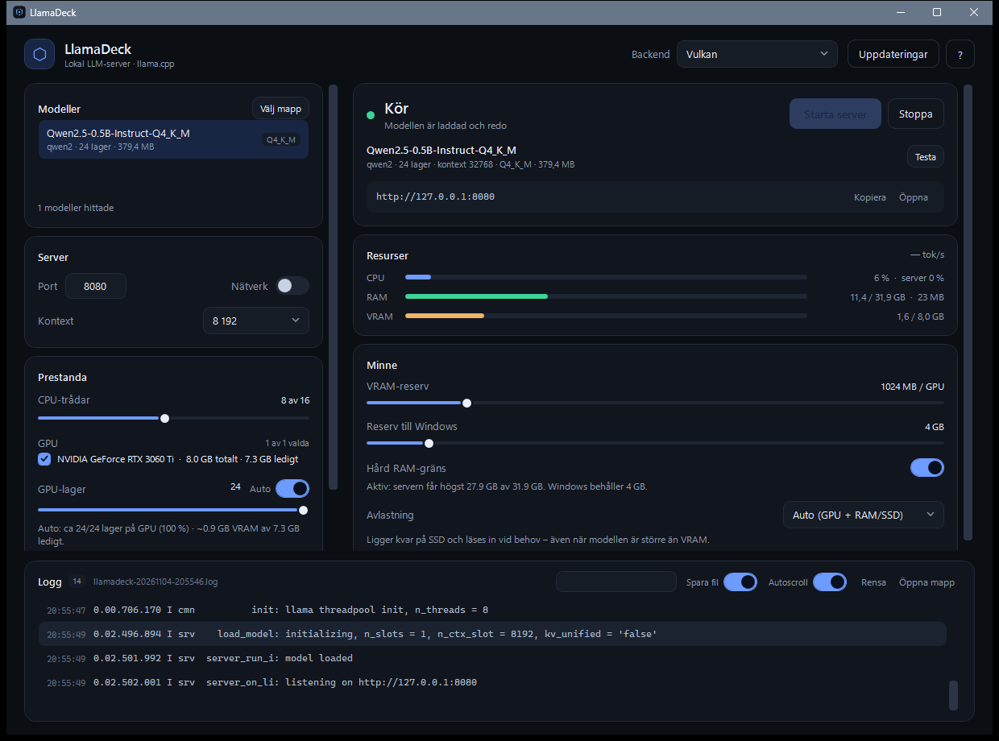

# LlamaDeck

En liten, mörk kontrollpanel för **llama.cpp** på Windows. Välj mapp med GGUF-modeller, tryck
**Starta server** – och du har en OpenAI-kompatibel lokal LLM-server med GPU-offload, minnesvakt
och logg i ett och samma fönster.

Repot innehåller källkoden för två program, båda WPF-appar för .NET 10:

| Projekt | Vad det är |
|---|---|
| `src/LlamaDeck` | Huvudprogrammet – mappval, serverstart, backends, kluster, uppdateringar |
| `src/LlamaDeckNode` | Klusternod – körs på de andra datorerna när en stor modell delas över nätet |

Systerversionen som visar alla `llama-server`-flaggor ligger i ett eget repo:
[llamadeck-pro](https://github.com/mange-ctrl/llamadeck-pro).

---



---

## Funktioner

### Server
- **Starta / Stoppa** llama-server med ett klick. Servern körs som barnprocess och stängs när
  programmet stängs.
- **Port** att välja själv (standard 8080) med kontroll att porten är ledig.
- **Lokal eller nätverk**: av = bara `127.0.0.1`, på = lyssnar på `0.0.0.0` så andra enheter kan
  ansluta. Adressen visas och kan kopieras.
- **Endpoint + knappar** för att kopiera adressen eller öppna llama.cpp:s inbyggda webbgränssnitt.
- **Testa** skickar en liten fråga till servern och visar svaret i loggen – snabb kvittens på att
  allt fungerar. Testet ger modellen **768 tokens**, så även resonemangsmodeller (DeepSeek-R1
  m.fl.) hinner tänka färdigt och svara. Om hela budgeten ändå gått till resonemang visas ett
  tydligt meddelande om det i stället för ett tomt svar.
- **Auto-omstart** (av som standard) startar servern igen om den kraschar.
- **API-nyckel** (valfri) skickas som `--api-key` så att nätverksläget kan skyddas. llama.cpp
  skyddar då `/v1/*`, `/metrics` och `/props`; `/health` är alltid öppen. Klienter måste skicka
  `Authorization: Bearer <nyckel>`. LlamaDeck skickar nyckeln på sina egna anrop, så statusrad,
  tok/s och testknappen fungerar även med nyckel.
- Servern startas alltid med **`--jinja`**: llama.cpp använder modellens egen chattmall, vilket
  krävs för verktygsanrop och för modeller vars mall inte finns i det äldre läget.

### Modeller
- Välj vilken **mapp som helst** med `.gguf`-filer. Underkataloger genomsöks.
- **Flera mappar samtidigt**: skriv dem åtskilda med `;` i `modelFolder` i `config.json`,
  t.ex. `"G:\ai modeler ocensur;G:\ai models 2;H:\gguf"`. *Välj mapp* lägger till mappar
  (Ctrl+klick för flera) i stället för att byta ut den gamla.
- Listan visar namn, arkitektur, antal lager, kvantisering och storlek. LlamaDeck läser GGUF-headern
  direkt – inget extra program behövs. Delade modeller (`00001-of-0000X`) listas en gång.
  Visionsprojektorer (`*mmproj*`) och draft-modeller (`*-assistant`) filtreras bort – de går inte
  att starta som vanliga modeller.
- **Konvertera safetensors till GGUF**: llama.cpp kan bara läsa GGUF, så en Hugging Face-modell måste
  konverteras först. Knappen *Konvertera…* kör llama.cpp-projektets `convert_hf_to_gguf.py` med ditt
  Python (kräver `torch`, `transformers` och `gguf`) och kvantiserar sedan med `llama-quantize`.
  Skripten hämtas från `https://github.com/ggml-org/llama.cpp/archive/refs/tags/<tagg>.tar.gz` och
  läggs i `%LOCALAPPDATA%\LlamaDeck\converter\<tagg>\` (`convert_hf_to_gguf.py`, `conversion\`,
  `gguf-py\`). Resultatet hamnar bredvid källmappen och dyker upp i modellistan direkt.
- **Läge Auto/Manuell**: längst upp i modellkortet väljer du *Auto* eller *Manuell*.
  I **Auto** läser LlamaDeck modellens GGUF-metadata (lager, huvuden, kontextlängd, MoE), ledigt
  VRAM, ledigt RAM och om disken är mekanisk, och ställer in kontext, GPU-lager, MoE-experter,
  KV-typ, inläsning och bildstöd själv – de reglagen **gråas ut** medan Auto är valt, eftersom
  LlamaDeck äger dem. I **Manuell** är allt fritt att ändra. Port, RAM-reserv, API-nyckel och
  extra argument är aldrig låsta.
  Det du ändrar manuellt **sparas per modell** i `profiles.json` och används nästa gång modellen
  väljs, så Auto-läget skriver aldrig över ett värde du själv har satt.
- Senast använda modell och mapp kommer ihåg.
- **Bildstöd (mmproj)**: slå på reglaget *Bildstöd (mmproj)* och välj visionsfil. LlamaDeck letar
  upp `*mmproj*.gguf` i modellmappen, föredrar den som ligger bredvid vald modell och skickar
  `--mmproj <fil>` till llama-server. **Bild-ubatch** (`-ub`) styr hur många bildtoken som får
  bearbetas per batch: `0` låter llama.cpp välja, men **Gemma 4 kräver minst 1120** för bilder –
  annars kapas budgeten och bilden beskrivs sämre eller inte alls. Modeller utan mmproj påverkas
  inte (argumenten skickas bara när reglaget är på).

### GPU och VRAM
- **CPU, Vulkan, CUDA 12/13, ROCm, SYCL eller OpenCL** väljs i huvudfönstret.
- **Upp till 4 grafikkort** samtidigt. Korten listas med totalt/ledigt minne och kan kryssas i.
  Modellen fördelas automatiskt proportionellt mot ledigt VRAM (`--tensor-split`).
- **GPU-lager**: Auto låter llama.cpp fylla grafikkortet och håller din reserv fri. Du kan också
  låsa antalet lager själv.
- **VRAM-reserv**: ställ in hur många MB som ska lämnas fritt per kort (t.ex. till skrivbordet).
  Används som marginal (`--fit-target`).
- **Flash attention** och **KV-cache-kvantisering** (f16/q8_0/q4_0) för att spara minne.
- Uppskattning av VRAM-behov och antal lager som får plats visas direkt när du väljer modell.
- **Varning när kontexten inte får plats**: räknar ut KV-cachen för vald kontext och varnar i
  loggen om den äter upp VRAM. Då laddas modellen delvis på processorn och svarar mycket
  långsamt – sänk kontexten i stället.

### Minne och stora modeller
- **Avlastning**:
  - *Auto (GPU + RAM/SSD)* – modellen ligger kvar på SSD och läses in vid behov (mmap). Det som
    inte får plats i VRAM körs i RAM, så modeller större än grafikkortet startar ändå.
  - *Läs in allt i RAM* (`-lm none`) och *Lås i RAM* (`mlock`) finns också.
  - *Endast CPU*.
- **Reserv till Windows**: ställ in hur många GB som alltid ska vara kvar. Med **hård RAM-gräns**
  sätts ett tak via Windows jobbobjekt, så servern inte kan äta upp allt minne och hänga datorn.
- **CPU-trådar** ställs in med slider (1 till antal logiska kärnor).
- **Kontextstorlek** väljs i listan; varning om modellen är tränad för kortare kontext.

### Kluster – dela en stor modell över flera datorer (beta)

Klustret ligger i `src/LlamaDeck` (fönstret `ClusterWindow`); nodprogrammet är
`src/LlamaDeckNode`.

- **Kluster-kortet** i vänsterpanelen: lägg till noder med IP:50052, testa att de svarar och
  se varje nods minne och grafikkort (nodens exe rapporterar det på port 50053).
- **Lagerfördelning**: tomt = llama.cpp fördelar lagren jämnt; 1,1,2 viktar en starkare nod
  tyngre. Maskinerna behöver inte vara identiska – bara samma llama.cpp-version.
- Servern startas med --rpc <noder> och --fit off -ngl 99 så att lagren fördelas över lokala
  kort och noder. Kommandot syns under *Avancerat*.
- **Beta och stabil delar inställningsfil** (%LOCALAPPDATA%\LlamaDeck\config.json). Kör du den
  stabila versionen efter beta kan kluster- och MoE-inställningarna nollställas – lägg då till
  noderna igen. Backendarna delas, så CUDA behöver inte hämtas om.
- **Vad det ger**: mer minne, inte högre fart. Varje token går igenom noderna i tur och ordning,
  så en enskild användare får summan av alla noders arbetstid plus nätverksfördröjning.

### MoE – experter på processorn

För modeller med experter (t.ex. Qwen3.6-35B-A3B, DeepSeek-R1-MoE) visas ett **MoE-kort**:

- **Auto** – llama.cpp fyller VRAM först (standard).
- **Delvis på CPU** – --n-cpu-moe N: N lager får sina expertvikter i RAM, resten på GPU.
- **Alla experter på CPU** – --cpu-moe: frigör mest VRAM åt uppmärksamhet, KV-cache och fler
  lager. Rekommenderas när modellen är större än grafikkortet.

### Mätare och logg
- **CPU, RAM och VRAM** mäts varje sekund, plus serverns egen CPU/RAM och **tok/s** från serverns
  `/metrics`.
- **Loggfönstret längst ner** visar allt llama.cpp skriver, färgkodat efter nivå, med tidsstämplar.
- **Spara logg** som slide-switch: på = loggen skrivs till fil i loggmappen (en fil per körning).
- **Autoscroll**, **filter** och **Rensa** i loggverktygsraden.

### Uppdateringar
Knappen **Uppdateringar** jämför med senaste versionerna och kan ladda ner direkt i programmet:
- **llama.cpp** – alla installerade varianter (CPU/Vulkan/CUDA) uppdateras till senaste bygget.
- **CUDA 12 / CUDA 13** – hämtar llama.cpp:s CUDA-bygge plus NVIDIA:s runtime (~600–650 MB) och
  lägger i rätt backend-mapp.
- **ROCm** – llama.cpp byggt med ROCm/HIP för AMD-grafik (~255 MB).
- **SYCL** – llama.cpp byggt med SYCL för Intel Arc och Intel-grafik (~149 MB).
- **Vulkan** – uppdaterar Vulkan-backend; visar installerad `vulkan-1.dll` och senaste SDK.
- **OpenCL** – visar systemets OpenCL-runtime (`OpenCL.dll` + antal plattformar) och senaste
  llama.cpp-version. llama.cpp publicerar bara OpenCL-byggen för ARM64/Adreno, så x64-varianten
  byggs från llama.cpp-källkoden och följer appens version; om ett officiellt x64-bygge dyker upp
  kan det hämtas härifrån.
- **NVIDIA-drivrutin** – visar installerad version/CUDA-stöd och länkar till NVIDIA.

### Extra som ingår
- Första-start-guide i loggen och ett **hjälpfönster** (?) som förklarar varje funktion.
- Portabelt läge: `--portable` eller en `portable.txt` bredvid exe-filen håller all data i
  programmappen.
- Kommandoförhandsvisning: se exakt vilken llama-server-kommando som körs (under *Avancerat*).
- Alla inställningar sparas automatiskt i `config.json`.
- En instans i taget, mörkt tema, anpassad fönsterstorlek som sparas.

---

## Kom igång

1. Kör `LlamaDeck.exe`. Första starten packar upp de inbyggda backenderna (CPU + Vulkan, några
   sekunder).
2. Tryck **Välj mapp** och peka på mappen där dina `.gguf`-filer ligger.
3. Välj modell i listan. Kontrollera backend (Vulkan är förvalt och fungerar på de flesta kort),
   port och minnesreserv.
4. Tryck **Starta server**. Statusraden visar *Kör* när modellen är laddad, och adressen
   `http://127.0.0.1:8080` kan användas direkt.

### Köra ett kluster

1. Kopiera **LlamaDeckNode.exe** till varje extradator (Windows x64). Starta den – den packar upp
   en liten RPC-server och visar en adress, t.ex. 192.168.1.42:50052.
2. Öppna port **50052** (RPC) och **50053** (info) i brandväggen på noderna.
3. I LlamaDeck (beta): **Kluster → Hantera noder…**, klistra in adressen, tryck **Lägg till**.
   Status *svarar* betyder att datorn nås, och minne/GPU visas automatiskt.
4. Starta servern som vanligt. Lagren fördelas över lokala kort och noderna.

Nodens exe har samma llama.cpp-version som LlamaDeck (b12110). Blandar du in en nod med annan
version kan anslutningen misslyckas – uppdatera båda då.

### Använda API:t

```bash
curl http://127.0.0.1:8080/v1/chat/completions \
  -H "Content-Type: application/json" \
  -d "{\"messages\":[{\"role\":\"user\",\"content\":\"Hej! Vad är 2+2?\"}]}"
```

OpenAI-klienter fungerar med `base_url = http://127.0.0.1:8080/v1` (och `api_key` om du satt en
nyckel). Den inbyggda webbgränssnittet nås på `http://127.0.0.1:8080/`.

---

## Var sparas allt?

Som standard i `%LOCALAPPDATA%\LlamaDeck`:

```
config.json          inställningar
profiles.json        testade/sparade inställningar per modell (se nedan)
backends\            llama.cpp-varianter (cpu, vulkan, cuda12, cuda13)
converter\<tagg>\    convert_hf_to_gguf.py + conversion\ + gguf-py\ för safetensors-konvertering
logs\                loggfiler
models\              standardmapp om du inte väljer en egen
```

`profiles.json` har modellens **filnamn** som nyckel, så profilen följer filen oavsett mapp. Bara de
fält du anger används – resten lämnas orörda:

```json
{
  "Qwen3.6-35B-A3B-Q4_K_M.gguf": {
    "note": "Testad 2026-11-10 – 19,2 tok/s",
    "contextSize": 8192,
    "threads": 8,
    "gpuLayersAuto": false,
    "gpuLayers": 99,
    "moeMode": "AllCpu",
    "kvCacheType": "f16",
    "offload": "Auto",
    "mmprojEnabled": false
  }
}
```

När en modell väljs läggs profilen in automatiskt (loggen skriver *Profil använd för …*). Saknas en
profil räknar *Anpassa efter modellen* fram värdena. Varje gång servern startas sparas de värden som
faktiskt användes tillbaka till profilen, så egna ändringar finns kvar nästa gång.

Portabelt läge (`--portable`) lägger samma struktur i `data\` bredvid exe-filen. Om mappen inte är
skrivbar faller programmet tillbaka på `%LOCALAPPDATA%`.

---

## Backends och storlekar

| Variant | Ingår i exe | Storlek efter uppackning | Kräver |
|---|---|---|---|
| CPU | Ja | ~61 MB | – |
| Vulkan | Ja | ~101 MB | Fungerande Vulkan-drivrutin (de flesta GPU:er) |
| OpenCL | Ja | ~27 MB | Intel- eller Adreno-grafik med OpenCL-runtime (NVIDIA/AMD använder CUDA/Vulkan) |
| CUDA 12 | Nej, hämtas i Uppdateringar | ~1,2 GB | NVIDIA-kort + drivrutin |
| CUDA 13 | Nej, hämtas i Uppdateringar | ~1,3 GB | NVIDIA-kort + nyare drivrutin |
| ROCm | Nej, hämtas i Uppdateringar | ~255 MB nedladdning | AMD-grafik med HIP-drivrutin |
| SYCL | Nej, hämtas i Uppdateringar | ~149 MB nedladdning | Intel Arc/Iris med drivrutin |

CUDA-bygget är stort eftersom NVIDIA:s runtime (cublas m.m.) ingår. CPU, Vulkan och OpenCL räcker
för att komma igång offline; CUDA ger bäst fart på NVIDIA. OpenCL-varianten är byggd med MSVC och
innehåller VC-runtime, så den kräver inget extra på datorn.

---

## Felsökning

- **"Porten används redan"** – välj en annan port eller stäng programmet som använder den.
- **"Minnet räckte inte"** – sänk kontextstorleken, minska antalet GPU-lager eller höj
  VRAM-reserven. Med *Auto* avlastning kan modellen vara större än VRAM men blir långsammare.
- **Backend saknas** – öppna *Uppdateringar* och hämta varianten, eller välj CPU/Vulkan.
- **Ingen GPU hittas** – kontrollera att drivrutinen är installerad. Vulkan kräver en fungerande
  Vulkan-runtime; NVIDIA-kort kan använda CUDA.
- **AMD eller Intel?** – AMD använder **ROCm** eller Vulkan, Intel använder **SYCL**, Vulkan eller OpenCL.
  Alla tre hämtas/installeras i samma fönster.
- **OpenCL hittar ingen GPU** – llama.cpp:s OpenCL-backend stöder bara **Intel- och Adreno-grafik**.
  På NVIDIA/AMD fungerar CUDA respektive Vulkan; OpenCL-varianten kör då bara på processorn.
- **Modellen svarar inte alls** – tre vanliga orsaker:
  1. *Kontexten är för stor.* 128k kontext på ett 8 GB-kort ger en KV-cache på flera GB mer än
     VRAM; modellen hamnar på processorn (mätt: ~2–27 tok/s i stället för normalt). Sänk till
     8 192–32 768. LlamaDeck varnar i loggen vid start.
  2. *Klienten skickar en enorm prompt.* Verktyg som Claude Code och OpenCode skickar lätt
     50 000–100 000 tokens. Vid ~400 tok/s tar bara inläsningen flera minuter, och det ser ut som
     att servern hängt sig. Titta i loggen efter `prompt processing … progress`.
  3. *Modellen resonerar.* DeepSeek-R1-klassen skriver hundratals tokens tankar innan svaret
     börjar. **Testa** hanterar det; egna klienter måste ge modellen tillräckligt med
     `max_tokens` (768+) och läsa `reasoning_content`.
- **"Invalid API Key" i loggen** – du har satt en API-nyckel i LlamaDeck, men något anrop saknade
  den. llama.cpp svarar 401 på `/v1/*`, `/metrics` och `/props` när `--api-key` är satt (bara
  `/health` är öppen). Sedan den här versionen skickar LlamaDeck nyckeln även på metrics- och
  hälsoanropen, så felet ska inte längre komma från appen. Egna klienter måste skicka
  `Authorization: Bearer <nyckel>`.
- **Använda servern från en OpenAI-klient (DeepSeek Harness, Rigg, Open WebUI m.fl.)**:
  - Adress: `http://127.0.0.1:8080/v1` (eller `http://<ip>:8080/v1` i nätverksläge).
  - API-nyckel: har LlamaDeck **ingen** nyckel räcker vilket värde som helst (t.ex. `local`) –
    llama.cpp struntar i Authorization-headern då. Har du satt en nyckel måste klienten använda
    exakt samma.
  - Modell: id:t från `/v1/models`, oftast sökvägen till .gguf-filen.
- **Windows SmartScreen** – exe-filen är inte codesignad. Välj *Mer information → Kör ändå*.

---

## Bygga själv

Kräver **.NET 10 SDK** och Windows (WPF).

```powershell
git clone https://github.com/mange-ctrl/llamadeck.git
cd llamadeck
dotnet publish src/LlamaDeck/LlamaDeck.csproj -c Release -r win-x64 --self-contained true `
  -p:PublishSingleFile=true -p:EnableCompressionInSingleFile=true `
  -p:IncludeNativeLibrariesForSelfExtract=true -o dist
```

Resultatet blir `dist/LlamaDeck.exe` – en fil utan .NET-beroenden på måldatorn.
Klusternoden byggs likadant från `src/LlamaDeckNode/LlamaDeckNode.csproj`.

### Backends

`src/LlamaDeck/Assets/backends.zip` **ingår inte i repot** – den innehåller
llama.cpp:s Windows-byggen (CPU/Vulkan/OpenCL, sammanlagt ~190 MB) och
`Assets/rpc.zip` i noden är llama.cpp:s RPC-server. Saknas zip-filerna bygger
projektet ändå, men då måste backendarna hämtas via *Uppdateringar* i programmet
eller läggas på plats manuellt.

Testlägen (används vid utveckling): `--selftest <fil>` skriver en
diagnostikrapport, `--smoke <fil>` startar servern och gör ett chattanrop,
`--screenshot <png>` renderar fönstret.

---

## Licenser

- [llama.cpp](https://github.com/ggml-org/llama.cpp) – MIT. OpenCL-varianten är byggd från samma källa
  (b12110) med MSVC.
- Microsoft Visual C++ runtime (msvcp140/vcruntime140/vcomp140) – medföljer OpenCL-mappen enligt
  Microsofts redistributionsvillkor.
- CUDA-runtime som laddas ner tillhör NVIDIA och omfattas av NVIDIA:s licens.
- LlamaDeck är ett eget skal och innehåller ingen modelldata.
